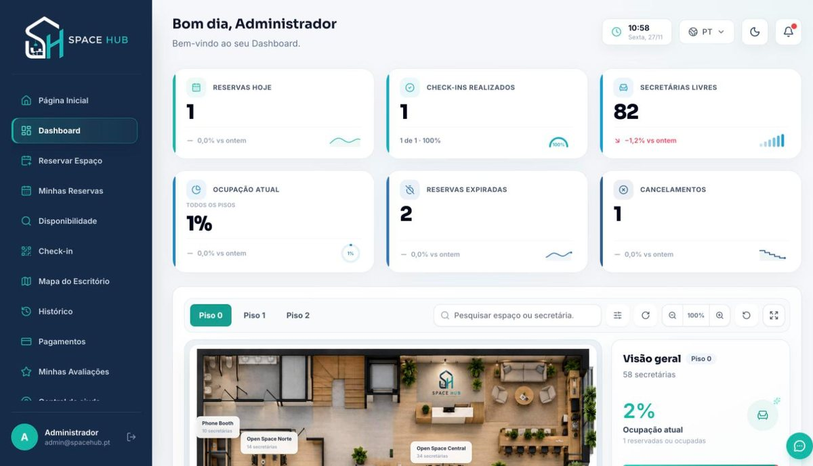
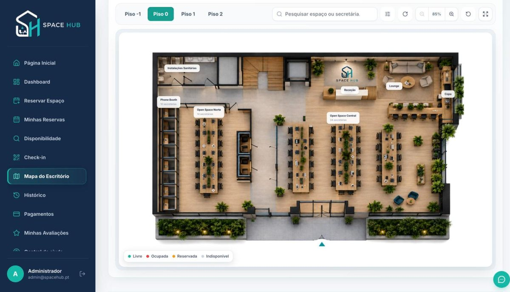
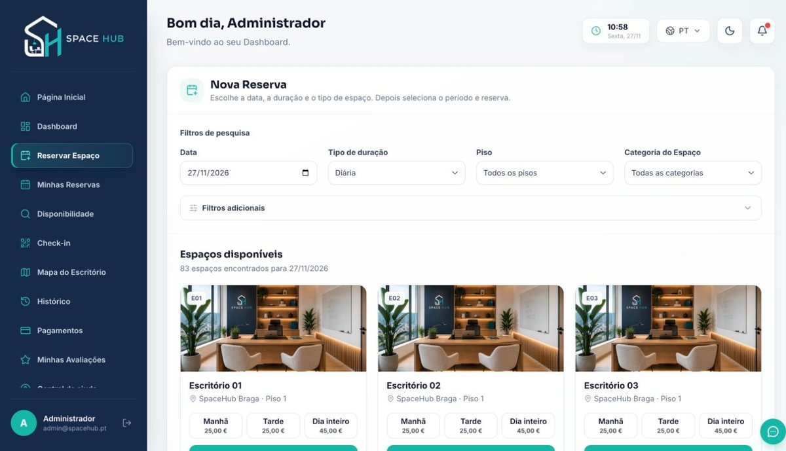

<div align="center">
  <picture>
    <source media="(prefers-color-scheme: dark)" srcset="public/images/logo/logoprincipalbranco.png">
    
  </picture>
  <h3>Sistema de Gestão e Reserva de Espaços Colaborativos</h3>
  <p>
    Plataforma web para gerir edifícios, pisos, setores e secretárias, com reservas,<br>
    check-in por QR Code, pagamentos simulados e monitorização da ocupação em tempo real.
  </p>
  <p>
    
    
    
    
    
    
    
  </p>
  <p><a href="https://spacehub-j6gd.onrender.com/"><strong>▶️ Ver aplicação online</strong></a></p>
  <p><sub>⏳ Alojado em plano gratuito: a primeira abertura pode demorar cerca de 1 minuto.</sub></p>
</div>

---

## 📑 Índice

- [Sobre o projeto](#-sobre-o-projeto)
- [Demonstração](#-demonstração)
- [Funcionalidades](#-funcionalidades)
- [Stack tecnológica](#️-stack-tecnológica)
- [Arquitetura](#️-arquitetura)
- [Segurança](#-segurança)
- [Instalação](#-instalação)
- [Testes e qualidade](#-testes-e-qualidade)
- [Documentação](#-documentação)
- [Equipa e contributos](#-equipa-e-contributos)
- [Licença](#-licença)

---

## 📖 Sobre o projeto

O **SpaceHub** resolve um problema concreto dos espaços de trabalho partilhados: saber
o que está livre, reservar um posto e confirmar a presença sem fricção.

A aplicação organiza o espaço físico numa hierarquia de quatro níveis e mapeia-a numa
planta interativa, sobre a qual assentam as reservas, os pagamentos e as estatísticas:

```text
Edifício
└── Piso
    └── Setor
        └── Secretária
```

Um utilizador consulta a disponibilidade, reserva uma secretária por período ou por
duração longa, paga (em ambiente simulado) e faz check-in lendo o QR Code do posto —
ou na receção, com validação assistida. Cada check-in atualiza o mapa em tempo real
via WebSockets, e os gestores acompanham a ocupação através de dashboards e relatórios.

Projeto académico desenvolvido por uma equipa de quatro elementos, com fluxo de trabalho
profissional em Git: branches de funcionalidade, Pull Requests, revisão e merge commits.

---

## 🎬 Demonstração

A aplicação está publicada em **[spacehub-j6gd.onrender.com](https://spacehub-j6gd.onrender.com/)**.

> ⏳ Alojada em plano gratuito: depois de algum tempo sem visitas, a primeira abertura pode demorar cerca de 1 minuto.

<table>
<tr>
<td width="50%" align="center"><b>Página inicial</b><br></td>
<td width="50%" align="center"><b>Dashboard</b><br></td>
</tr>
<tr>
<td width="50%" align="center"><b>Mapa do escritório</b><br></td>
<td width="50%" align="center"><b>Nova reserva</b><br></td>
</tr>
</table>

**Contas de demonstração**

| Papel | Email | Palavra-passe |
| --- | --- | --- |
| Administrador | `admin@spacehub.pt` | `password123` |
| Gestor | `gestor@spacehub.pt` | `password123` |
| Colaborador | `colaborador@spacehub.pt` | `password123` |
| Utilizador | `utilizador@spacehub.pt` | `password123` |

---

## ✨ Funcionalidades

| Módulo | O que faz |
| --- | --- |
| 👤 **Autenticação** | Registo, login, recuperação de palavra-passe, perfil com fotografia, contas ativas/inativas, Single Sign-On e API com Laravel Sanctum. |
| 🏢 **Gestão de espaços** | CRUD de edifícios, pisos, setores e secretárias com pesquisa, filtros, ordenação, paginação, plantas dos pisos e posicionamento gráfico no mapa. |
| 📅 **Reservas** | Consulta de disponibilidade, validação de conflitos, durações diária a anual, períodos de manhã/tarde/dia inteiro, expiração automática e histórico. |
| 💳 **Pagamentos simulados** | Criação automática por reserva, cálculo do valor, referência única, comprovativo e quatro métodos (Cartão, MB Way, Transferência, PayPal). |
| 📱 **QR Code e check-in** | QR Code único por secretária, leitura pela câmara, validação de utilizador/reserva/data/período e confirmação presencial assistida na receção. |
| 📊 **Dashboard e mapa** | Taxa de ocupação, reservas por estado/período/edifício, próximas reservas, gráficos Recharts e mapa interativo atualizado em tempo real. |
| ⭐ **Avaliações** | Classificação e comentários em reservas elegíveis, média por setor, moderação e regras de autorização. |
| 🔔 **Notificações** | Notificações persistentes com estado de leitura para reservas, pagamentos, check-in, avaliações e suporte. |
| 💬 **Tempo real** | Laravel Reverb + Echo sobre WebSockets, com o evento `MapaAtualizado` a propagar alterações de ocupação. |
| 🆘 **Help Center** | FAQs por categoria, assistente virtual baseado nas FAQs, pedidos de suporte, reporte de avarias e resposta administrativa. |

<details>
<summary><strong>Ver detalhe completo de cada módulo</strong></summary>

### 👤 Autenticação e utilizadores

Registo, login e logout, recuperação e redefinição da palavra-passe, gestão do perfil,
fotografia de perfil, contas ativas e inativas, gestão administrativa de utilizadores,
papéis e permissões, autenticação da API com Laravel Sanctum, Single Sign-On e ligação
opcional ao Google Calendar para sincronização das reservas.

Papéis existentes: **Administrador**, **Gestor**, **Colaborador** e **Utilizador**.
Os papéis são fixos e criados através de seeders — não existe CRUD de papéis.

### 🏢 Gestão de espaços

Gestão de edifícios, pisos, setores e secretárias, com pesquisa, filtros, ordenação,
paginação e ativação/desativação lógica. Inclui upload e substituição das plantas dos
pisos, características das secretárias, posicionamento no mapa através de editor gráfico
e QR Code único por secretária.

### 📅 Reservas

Criação, consulta, edição, cancelamento e histórico; consulta de disponibilidade e
validação de conflitos; check-in por QR Code ou presencial assistido por Administrador,
Gestor ou Colaborador; expiração automática; atualização do mapa em tempo real; e
associação automática a um pagamento.

- **Durações:** diária, semanal, mensal e anual.
- **Períodos:** Manhã, Tarde e Dia inteiro.
- **Estados:** pendente, confirmada, cancelada e expirada.

As reservas longas utilizam o período *Dia inteiro*, têm data final calculada e
correspondem a um único registo de reserva e a um único pagamento.

### 💳 Pagamentos simulados

Criação automática, cálculo do valor, referência única, consulta, confirmação,
cancelamento, histórico, comprovativo e controlo de acesso.

- **Métodos:** Cartão, MB Way, Transferência Bancária e PayPal.
- **Estados:** pendente, pago e cancelado.

> Os pagamentos são simulados para fins académicos. Não existe movimentação financeira real.

### 📱 QR Code e check-in

Geração do QR Code, leitura através da câmara, validação do utilizador, da reserva e da
data/período/secretária, confirmação do check-in, confirmação presencial na receção para
reservas elegíveis, registo do funcionário responsável no histórico de atividade,
atualização do estado para *confirmada* e atualização do mapa.

### 📊 Dashboard, estatísticas e mapa

Indicadores de utilização, taxa de ocupação, reservas por estado, por período e por
edifício, próximas reservas, mapa interativo com editor gráfico, atualização em tempo
real e gráficos com Recharts.

### ⭐ Avaliações

Avaliação de reservas elegíveis, classificação, comentários, moderação, média por setor
e regras de autorização.

### 🔔 Notificações

Notificações persistentes com estado de leitura, relacionadas com reservas, pagamentos,
check-in, avaliações e suporte, com comunicação em tempo real quando aplicável.

### 💬 Assistente virtual e tempo real

Laravel Reverb, Laravel Echo, broadcasting, WebSockets e eventos Laravel. O assistente
virtual é baseado nas FAQs e funciona por pedidos HTTP, não dependendo do Reverb. O
principal evento transmitido é `MapaAtualizado`. As operações de negócio permanecem
protegidas quando o serviço de broadcasting está indisponível.

### 🆘 Help Center

FAQs, categorias, conteúdos ativos, pedidos de suporte, reporte de problemas e avarias,
acompanhamento do estado, resposta administrativa e associação ao utilizador autenticado.

</details>

---

## 🛠️ Stack tecnológica

| Camada | Tecnologias |
| --- | --- |
| **Backend** | Laravel 12 · PHP 8.2 · Eloquent ORM · MySQL |
| **Frontend** | React 18.2 · Inertia.js · Tailwind CSS · Vite · Recharts |
| **Tempo real** | Laravel Reverb (servidor WebSocket) · Laravel Echo · Broadcasting |
| **Autenticação** | Laravel Sanctum · Policies · Gates · Middleware |
| **QR Code** | Simple QR Code (geração) · html5-qrcode (leitura pela câmara) |
| **Testes** | Pest 3 · PHPUnit · Vitest 4 |
| **Qualidade e CI** | Laravel Pint · GitHub Actions · Git e GitHub |

---

## 🏗️ Arquitetura

Arquitetura em camadas assente no padrão **MVC**, com a camada de apresentação em React
servida por Inertia.js — sem API pública para o frontend web, mas com uma API REST
autenticada por Sanctum para consumidores externos.

```text
Utilizador
    ↓
React + Inertia.js
    ↓
Rotas Web / API
    ↓
Middleware
    ↓
Controllers
    ↓
Form Requests · Policies · Services
    ↓
Models Eloquent
    ↓
MySQL
```

A **API REST** utiliza Laravel Sanctum, API Resources, Form Requests, Policies, Gates,
Middleware, Route Model Binding, Eloquent ORM e respostas JSON.
A **interface web** utiliza React, Inertia.js, Tailwind CSS, componentes reutilizáveis e
Controllers Laravel.

<details>
<summary><strong>Estrutura de pastas</strong></summary>

```text
app/
├── Events/
├── Http/
│   ├── Controllers/
│   │   └── Api/
│   ├── Middleware/
│   ├── Requests/
│   └── Resources/
├── Models/
├── Notifications/
├── Policies/
├── Providers/
└── Services/

database/
├── factories/
├── migrations/
└── seeders/

docs/
public/

resources/
├── css/
└── js/
    ├── Components/
    ├── Layouts/
    └── Pages/

routes/
├── api.php
├── channels.php
├── console.php
└── web.php

storage/

tests/
├── Feature/
└── Unit/
```

</details>

---

## 🔐 Segurança

Hashing das palavras-passe, autenticação por sessão e Laravel Sanctum para a API.
O acesso é controlado em várias camadas: middleware de autenticação, de conta ativa e de
papel; Policies e Gates; e verificação de propriedade dos recursos.

A validação de entrada é feita por Form Requests, com proteção contra mass assignment,
validação de uploads, listas seguras (allow-list) de campos de ordenação, revogação de
tokens e desativação lógica das entidades em vez de eliminação destrutiva.

---

## 🚀 Instalação

### Requisitos

PHP 8.2+ · Composer · Node.js e npm · MySQL ou MariaDB · Git · extensões PHP exigidas pelo Laravel.

### Instalação rápida

```bash
# 1. Clonar e entrar na pasta
git clone https://github.com/angela042026/SpaceHub.git
cd SpaceHub

# 2. Configurar o ambiente (Windows: copy .env.example .env)
cp .env.example .env
php artisan key:generate

# 3. Instalar dependências
composer install
npm install

# 4. Preparar a base de dados (criar antes a base `spacehub`)
php artisan migrate --seed

# 5. Storage e caches
php artisan storage:link
php artisan optimize:clear
```

Configuração de ligação esperada no `.env`:

```env
DB_CONNECTION=mysql
DB_HOST=127.0.0.1
DB_PORT=3306
DB_DATABASE=spacehub
DB_USERNAME=root
DB_PASSWORD=
```

### Execução

A aplicação usa quatro processos em paralelo — abrir quatro terminais na pasta do projeto:

```bash
php artisan serve          # Terminal 1 — aplicação Laravel  → http://127.0.0.1:8000
npm run dev                # Terminal 2 — Vite / frontend
php artisan reverb:start   # Terminal 3 — WebSockets (tempo real)
php artisan schedule:work  # Terminal 4 — tarefas agendadas
```

O **Reverb** é necessário para o chat, notificações e atualização do mapa em tempo real.
O **Scheduler** processa expirações de reservas, não comparências e outras tarefas automáticas.

> **Windows / PowerShell:** usar `npm.cmd` em vez de `npm` evita problemas com a política
> de execução de scripts.

<details>
<summary><strong>Notas de instalação detalhadas</strong></summary>

### Importar a base de dados entregue

Para avaliação, a estrutura e os dados são entregues separadamente no ficheiro
`spacehub_bd.sql`, que **não deve ser colocado no repositório Git**.

Via phpMyAdmin: criar ou selecionar a base `spacehub` → *Importar* → selecionar
`spacehub_bd.sql` → iniciar a importação → confirmar que as tabelas e os dados foram criados.

Via linha de comandos:

```bash
mysql -u root -p spacehub < spacehub_bd.sql
```

Não executar migrations sobre uma cópia já importada, salvo se souber que estão em falta.
As migrations e os seeders permanecem no projeto, mas a instalação para avaliação deve
utilizar o ficheiro SQL entregue.

### Migrations e seeders em desenvolvimento

```bash
php artisan migrate --seed          # base de dados vazia
php artisan migrate:fresh --seed    # recriar do zero — apaga todos os dados
```

⚠️ `migrate:fresh` elimina todos os dados. Não usar numa base com informação a preservar.

Os seeders cobrem papéis, utilizadores, períodos, estados das reservas, edifícios, pisos,
setores, secretárias, reservas, FAQs e os restantes módulos da versão atual.

### Storage e uploads

```bash
php artisan storage:link
```

Este comando publica em `public/storage` os ficheiros do disco público, incluindo:

```text
storage/app/public/utilizadores/fotografias
storage/app/public/pisos/plantas
```

Os recursos estáticos da aplicação encontram-se em `public/` e `resources/`.

### Porta do Reverb

Por predefinição o Reverb utiliza a porta `8080`. Se estiver ocupada pelo Apache ou por
outro serviço, configurar uma porta diferente em `REVERB_SERVER_PORT`, `REVERB_PORT` e nas
variáveis `VITE_REVERB_*`, reiniciar o Reverb e recompilar o frontend. A indisponibilidade
temporária do broadcasting é registada nos logs, mas não invalida operações de negócio já
concluídas.

### Compilar o frontend

```bash
npm run dev      # desenvolvimento
npm run build    # produção
```

### Ficheiro `.env`

O ficheiro `.env` nunca deve ser enviado para o repositório. Os dados reais de acesso
devem ser configurados apenas nesse ficheiro.

</details>

<details>
<summary><strong>Preparação para produção</strong></summary>

Usar `.env.production.example` como referência e copiar os valores necessários para o
`.env` do servidor. Nunca versionar o `.env` real nem reutilizar credenciais de desenvolvimento.

Antes de disponibilizar uma nova versão:

```bash
composer install --no-dev --optimize-autoloader
npm ci
npm run build
php artisan migrate --force
php artisan storage:link
php artisan optimize
```

Confirmar que `APP_ENV=production`, `APP_DEBUG=false`, `APP_URL` usa HTTPS e
`SESSION_SECURE_COOKIE=true`. Gerar uma chave exclusiva com `php artisan key:generate`
caso o ambiente ainda não tenha `APP_KEY`.

Processos supervisionados necessários:

```bash
php artisan queue:work --tries=3
php artisan reverb:start
```

Cron para o scheduler, a cada minuto:

```cron
* * * * * cd /caminho/do/spacehub && php artisan schedule:run >> /dev/null 2>&1
```

Após o deploy, confirmar `php artisan about`, `php artisan migrate:status`, os logs da
aplicação e os fluxos críticos de login, reserva, pagamento e check-in.

</details>

---

## 🧪 Testes e qualidade

| Suíte | Comando | Resultado |
| --- | --- | --- |
| Backend (Pest 3 / PHPUnit) | `php artisan test` | 351 testes aprovados · 1919 asserções |
| Frontend (Vitest 4) | `npm run test:frontend` | 20 testes aprovados · 3 ficheiros |

O **GitHub Actions** executa em cada integração o Laravel Pint, os testes PHP, os testes
de frontend e o build de produção.

<details>
<summary><strong>Checklist antes de uma integração ou entrega</strong></summary>

```bash
php artisan optimize:clear
composer dump-autoload
npm run build
php artisan test
php artisan route:list
php artisan route:list --path=api   # confirmar rotas da API
```

</details>

---

## 📚 Documentação

A documentação técnica encontra-se na pasta [`docs/`](docs/).

| Documento | Descrição |
| --- | --- |
| [`01-Requisitos.md`](docs/01-Requisitos.md) | Requisitos e regras de negócio |
| [`02-CasosDeUso.md`](docs/02-CasosDeUso.md) | Atores e casos de uso |
| [`03-ModeloBaseDados.md`](docs/03-ModeloBaseDados.md) | Entidades e relações |
| [`04-Arquitetura.md`](docs/04-Arquitetura.md) | Arquitetura técnica |
| [`05-API.md`](docs/05-API.md) | Endpoints, autenticação e respostas |
| [`06-Roadmap.md`](docs/06-Roadmap.md) | Evolução do projeto e trabalho futuro |
| [`07-DicionarioDados.md`](docs/07-DicionarioDados.md) | Estrutura das tabelas |

---

## 👥 Equipa e contributos

| Elemento | Responsabilidade principal |
| --- | --- |
| **Ângela Costa** | Administração, espaços, segurança, integração e documentação |
| **Eduardo** | Comunicação em tempo real, Reverb e assistente virtual |
| **Hanna Sampaio** | Dashboard, estatísticas, mapa interativo, QR Code e check-in; deploy em produção (Docker, Render e PostgreSQL), integração contínua (GitHub Actions) e dados de demonstração |
| **Joana Oliveira** | Reservas e fluxo de utilização |

O desenvolvimento foi integrado através de branches de funcionalidade, Pull Requests,
revisão e merge commits, preservando a autoria de cada commit:

```text
Branch de funcionalidade → Commit → Push → Pull Request → Revisão e testes → Merge commit → main
```

Este processo permitiu desenvolvimento paralelo, revisão das alterações, preservação da
autoria, histórico completo e menor risco nas integrações.

---

## 📄 Licença

Projeto desenvolvido em contexto académico, para fins educativos.

<div align="center">

**SpaceHub** — Laravel · React · Inertia.js · Tailwind CSS · MySQL · Sanctum · Reverb · Echo

</div>
